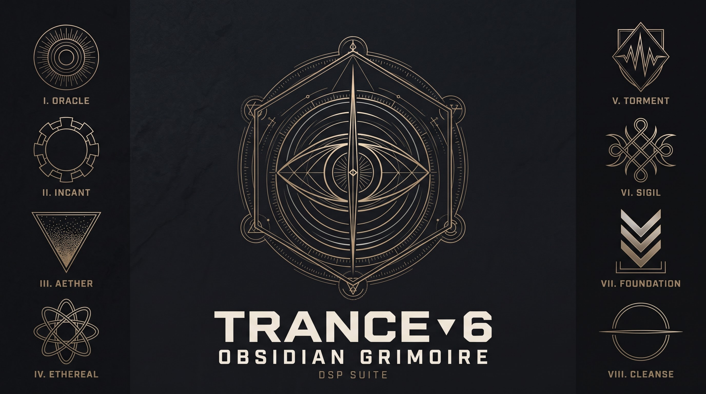

# The TRANCE-6 Obsidian Grimoire



Round two of the plugin line by **Red Flame Entertainment**: eight plugins on one shared
JUCE/C++ UI kit, packaged together as *The TRANCE-6 Obsidian Grimoire*. Per-plugin
emblems are in [`assets/emblems/`](assets/emblems).

- **ORACLE** - hybrid wavetable synth (royal blue)
- **SIGIL** - modal resonator synth (periwinkle)
- **ETHEREAL** - galactic space reverb (violet, effect)
- **INCANT** - groove generator / drum machine (gold)
- **AETHER** - sample-stack synth (orange)
- **TORMENT** - hi-fi lo-fi processor (sepia, effect)
- **FOUNDATION** - saturation + loudness (blue, effect)
- **CLEANSE** - mastering / dynamic EQ (gold, effect)

Four instruments, four effects. The point of the repo is the *kit*: `Source/redflame/`
is a header-only set of components (house LookAndFeel with brushed-metal knobs, panel
cards, top bar, the modulation-chip rail + drag-to-assign) that every plugin drops in
and re-skins with its own accent colour.

See [DESIGN.md](DESIGN.md) for the tokens and component list.

Each plugin is its own CMake target, sharing the header-only kit in `Source/redflame/`.

## Build
JUCE 8.0.4, C++17, CMake (same setup as the TRANCE-6 repos: uses a local `../JUCE`
checkout if present, otherwise fetches 8.0.4). Formats: VST3, AU, Standalone.

```bash
cmake -S . -B build
cmake --build build --target ORACLE_Standalone --config Debug
```

## Status
`v0.2.0` - the UI kit and the full ORACLE **SYNTH page**: top bar, the upper row
(OSC A / OSC B / HARMONICS / CALI / FILTER) and the lower row (ENVELOPES with ENV 1-3
tabs + AHDSR curve + faders, LFO with LFO 1-3 tabs + animated waveform, VOICE,
FILTER 2 with the vowel pad), the mod rail and keyboard. **Drag a rail chip onto any
knob** to assign modulation - a coloured mod-dot appears on the arc (drag = depth,
right-click = remove) and the assignment is saved with the preset.

ORACLE's processor is a small proof synth (two oscillators + noise -> ladder filter ->
master) so the standalone makes sound; master, cutoff/reso, osc levels, ENV 1 and tune
are live.

**SIGIL** (`v0.1.0`) is the second plugin on the kit: the full SYNTH page (engine strip
MODAL/SYMPATHETIC/INHARMONIC/FM/CHORDS + macros, and the EXCITER / RESONATOR / SPACE /
MOTION / PLAY / TOUCH panels) in periwinkle. Its voice is a Karplus-Strong resonator, so
strike / structure / brightness / damping / position + the exciter envelope and pitch
are live, with a reverb on the output. Build it with `--target SIGIL_Standalone`.

**ETHEREAL** (`v0.1.0`) is the first *effect* on the kit (violet): STACK, GALACTIC
SHIFT, SPIRAL (with the orbiting-globe visual), SPACE, INPUT, OUTPUT, PARTIALS, RUMBLE
and an IN/OUT bar - no keyboard. Its DSP is a real reverb path (drive -> pre-delay ->
lo/hi cut -> Freeverb -> dry/wet mix -> output), so it processes audio input. Build it
with `--target ETHEREAL_Standalone`.

**INCANT** (`v0.1.0`) is a groove generator (gold): an interactive 8-lane x 16-step
sequencer grid (click to add/remove a hit, drag for velocity), a genre strip with
**GENERATE**, PERFORM / GROOVE / MACROS panels and a per-lane detail strip. It has a
synthesized drum engine (kick / snare / hats / clap / tom / rim / ride) driven by a
tempo-synced step clock, so **PLAY** (or the host transport) plays the pattern. The
pattern persists with the preset. Build it with `--target INCANT_Standalone`.

**AETHER** (`v0.2.0`) is a sample-stack synth (orange): a 10-layer stack strip (each
card selectable, with a mini waveform + on/off + name), a per-layer editor (waveform
view with start/end markers, ON/LOOP/REVERSE/KEY-TRACK/AUTO-TUNE, and the layer knobs,
which sync to a "selected layer" param set so they carry mod-dots), dual filters with
A->B / A+B routing, a PATINA panel, envelope and 8 macros. Each layer is a synth
oscillator stand-in (sample loading from disk is the next step). Build it with
`--target AETHER_Standalone`.

**TORMENT** (`v0.1.0`) is a hi-fi lo-fi processor (sepia, effect): AGE, a CRT
oscilloscope display, CAPTURE, TAPE, DECIMATE, VINYL (33/45/78) and a big GRAIN panel.
Its DSP is a real per-sample lo-fi chain (tape drive + hiss -> bit/rate crush -> vinyl
noise + tone -> dry/wet). Build it with `--target TORMENT_Standalone`.

**FOUNDATION** (`v0.1.0`) is a saturation + loudness processor (blue, effect): the
EMBER-style signal-flow strip - INPUT, SATURATE (spectrum + tone knobs), COMPRESS
(COMP/OTT + reduce/shave meters), LOUD (limit meter) and OUTPUT, with live LUFS
readouts. Its DSP is a real chain: input -> saturate -> compress -> loudness -> limiter
-> dry/wet. Build it with `--target FOUNDATION_Standalone`.

**CLEANSE** (`v0.1.0`) is a mastering / dynamic EQ (gold, effect): a big interactive EQ
curve - drag the coloured band points to move frequency (x) and gain (y) - over a
spectrum and a piano strip, with a band list, a per-band editor (FREQ/GAIN/Q + type) and
an OUTPUT section (stage/character, drive/mix/output/ceiling). Its DSP is a real series
of biquad bands (bell/shelf/cut) built from the band model. Build it with
`--target CLEANSE_Standalone`.

Applying the full mod matrix to DSP, real sample loading, grain/capture + dynamic-EQ
sidechain DSP, the real resonator/wavetable engines, the other pages and the INSTRUMENT
skin are the next passes - see DESIGN.md.
